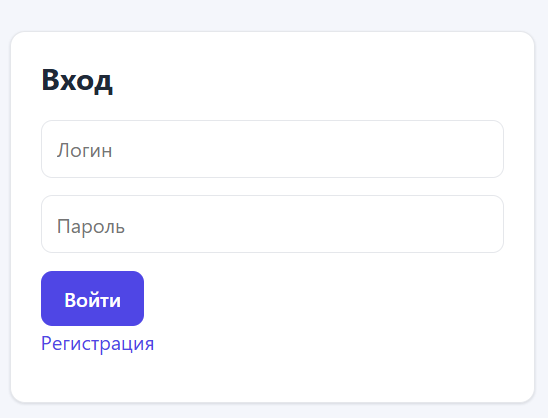
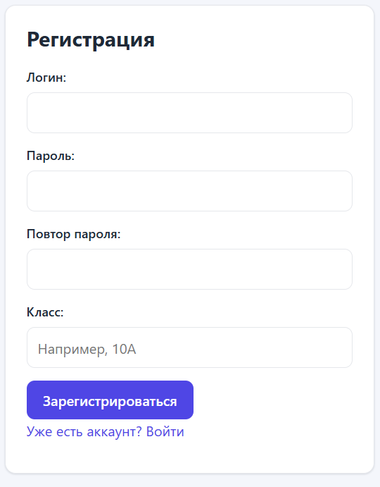
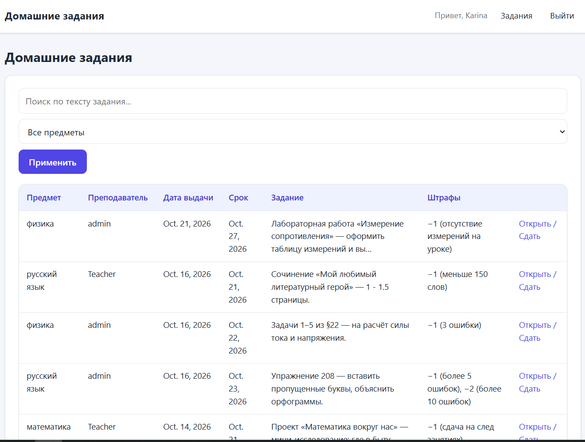
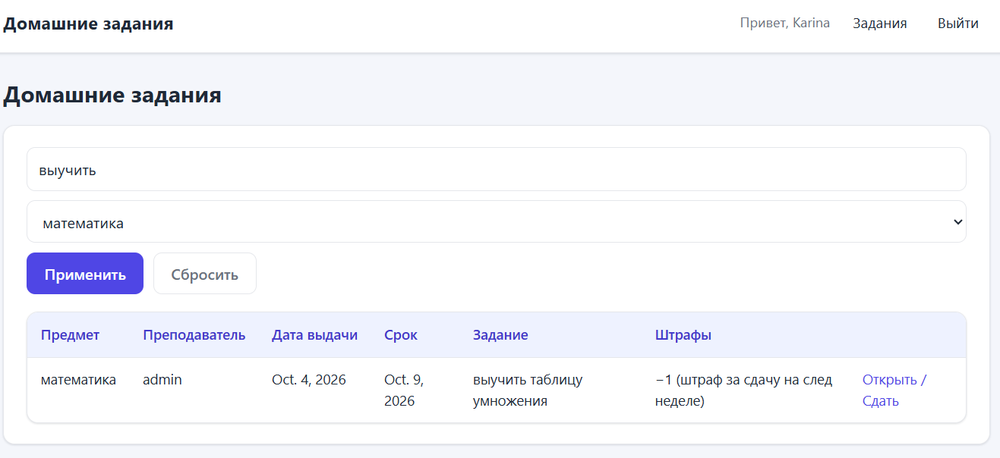
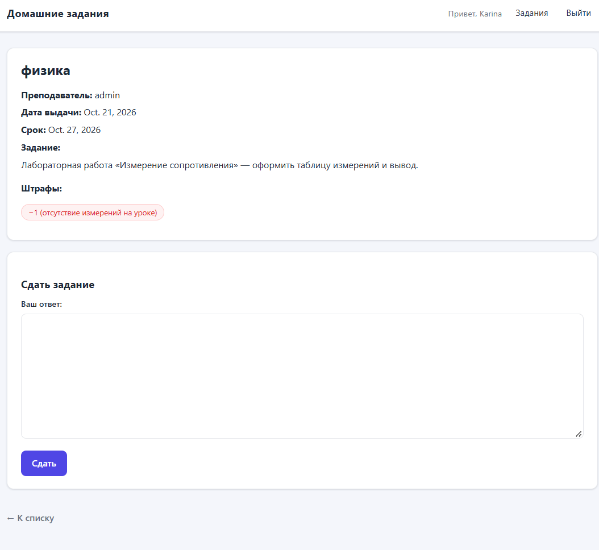
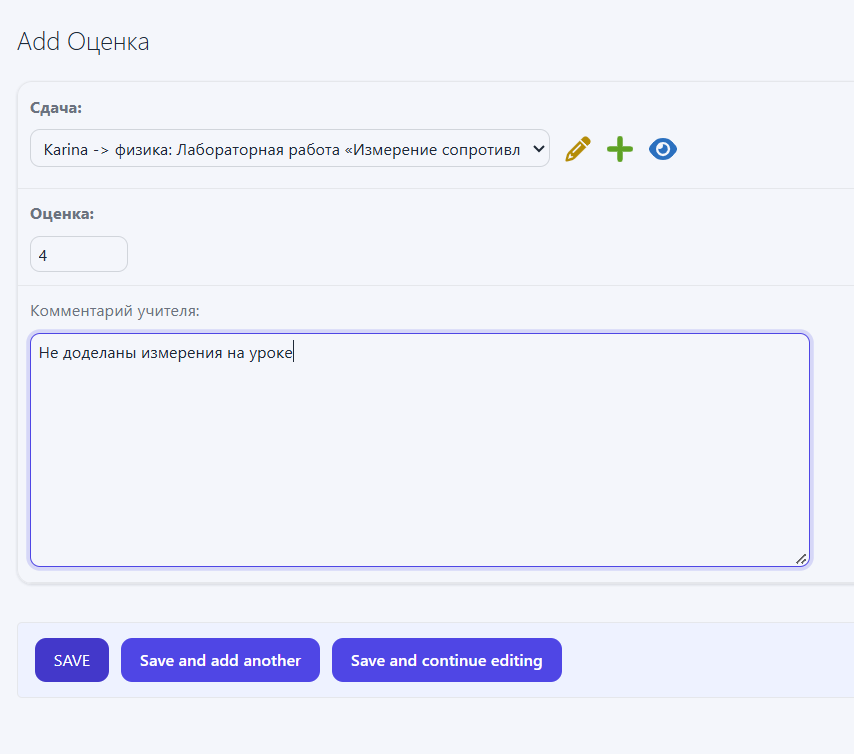
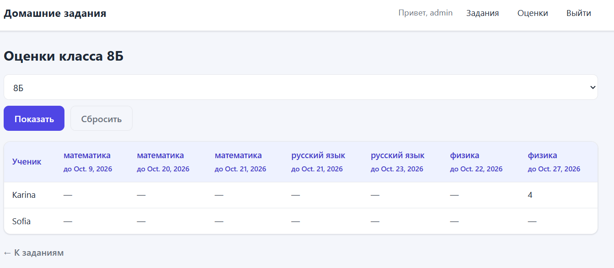
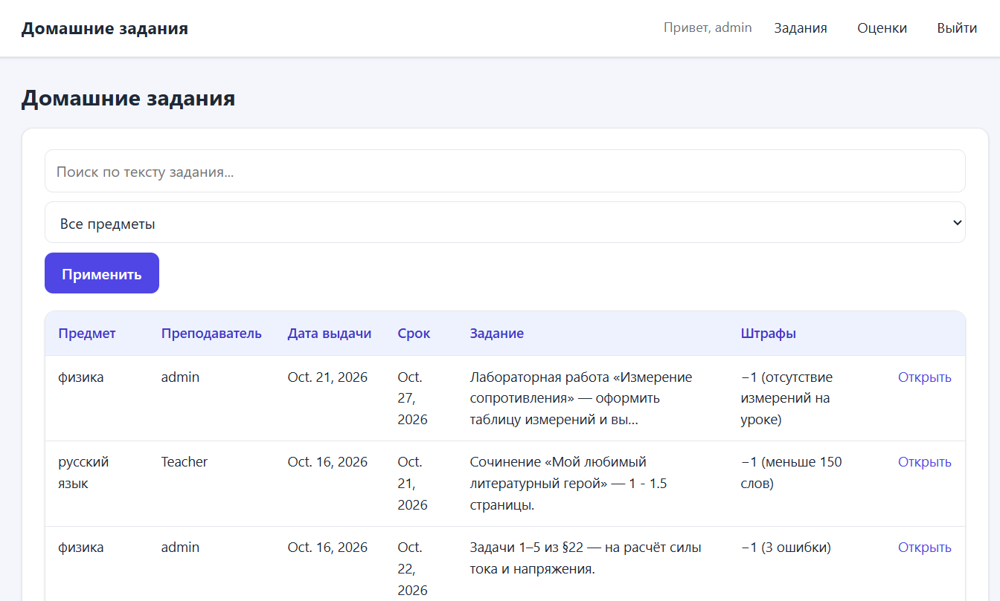
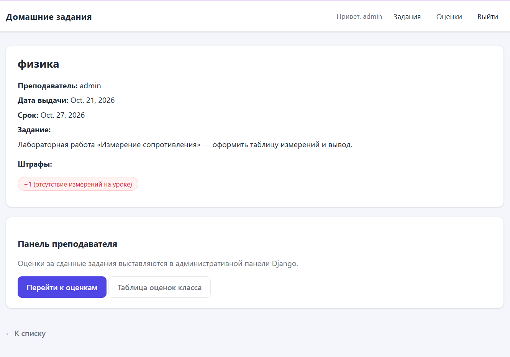
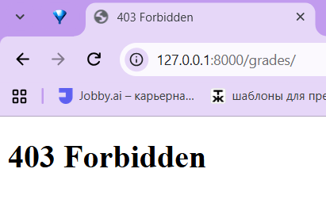

# Лабораторная работа №2. Веб-приложение на Django: домашние задания

**Студентка:** Мкртчян Карина, группа K3341
**Стек:** Python 3.14, Django 6.1, SQLite, HTML + собственный CSS

## Цель работы

Разработать веб-приложение на Django для работы с домашними заданиями: регистрация
пользователей, просмотр заданий по всем дисциплинам, сдача заданий в текстовом виде,
выставление оценок учителем и таблица оценок класса. Дополнительно реализованы стилизация
интерфейса, пагинация с поиском и фильтрацией, а также разграничение прав администратора и
обычного пользователя в клиентской части (а не только в Django-admin).

## Структура проекта

```
lab2/
├─ homework_project/      # настройки проекта, корневые urls
├─ users/                 # профиль пользователя, регистрация/вход/выход
├─ homework/              # предметы, задания, штрафы, сдачи, оценки
├─ templates/             # base.html, users/, homework/, admin/
└─ manage.py
```

Проект разбит на два приложения: `users` (аутентификация и профиль) и `homework`
(предметная логика). Общие шаблоны лежат в корневой папке `templates/`, которая подключена
в `settings.py` через `DIRS`.

## Модель данных

Модель продумана так, чтобы одними и теми же сущностями было удобно пользоваться: одна
сдача на ученика и задание, одна оценка на сдачу, штрафы вынесены в отдельную таблицу.

```python
class Homework(models.Model):
    subject = models.ForeignKey(Subject, on_delete=models.CASCADE,
                                related_name="homeworks", verbose_name="Предмет")
    teacher = models.ForeignKey(settings.AUTH_USER_MODEL, on_delete=models.SET_NULL,
                                null=True, blank=True, related_name="created_homeworks",
                                limit_choices_to={"is_staff": True},
                                verbose_name="Преподаватель")
    issued_at = models.DateField("Дата выдачи", default=timezone.now)
    deadline = models.DateField("Срок выполнения")
    text = models.TextField("Текст задания")


class Submission(models.Model):
    homework = models.ForeignKey(Homework, on_delete=models.CASCADE,
                                 related_name="submissions")
    student = models.ForeignKey(settings.AUTH_USER_MODEL, on_delete=models.CASCADE,
                                related_name="submissions",
                                limit_choices_to={"is_staff": False})
    text = models.TextField("Текст ответа")
    submitted_at = models.DateTimeField("Дата сдачи", auto_now_add=True)

    class Meta:
        unique_together = ("homework", "student")   # одна сдача на задание
```

Сущности: `Subject` (предмет), `Homework` (задание: предмет, преподаватель, дата выдачи,
срок, текст), `Penalty` (штраф по заданию — отдельной таблицей), `Submission` (сдача в
текстовом виде), `Grade` (оценка, `OneToOneField` к сдаче), `Profile` (класс ученика).

## Регистрация и вход

Регистрация реализована формой `RegisterForm` с проверкой уникальности логина и совпадения
паролей. При регистрации создаётся профиль ученика (`is_staff=False`) с указанием класса.

```python
class RegisterForm(forms.Form):
    username = forms.CharField(label="Логин", max_length=150)
    password = forms.CharField(label="Пароль", widget=forms.PasswordInput)
    password2 = forms.CharField(label="Повтор пароля", widget=forms.PasswordInput)
    school_class = forms.CharField(label="Класс", max_length=10, required=False,
        widget=forms.TextInput(attrs={"list": "class-list", "autocomplete": "off"}))

    def clean(self):
        cleaned = super().clean()
        if cleaned.get("password") and cleaned["password"] != cleaned.get("password2"):
            raise forms.ValidationError("Пароли не совпадают.")
        return cleaned
```

Чтобы не создавать классы заново и не опечатываться, поле «Класс» подсказывает уже
существующие значения через `<datalist>` — можно выбрать готовый класс или ввести новый.

**Скриншот 1.** Форма регистрации: видно поле
«Класс» с выпадающей подсказкой существующих классов.



**Скриншот 2.** Форма входа.



## Просмотр заданий: пагинация, поиск и фильтрация

Список заданий — это `ListView` с пагинацией по 5 записей. Поиск идёт по тексту задания,
фильтр — по предмету; оба работают по одному пагинируемому набору, а параметры поиска
сохраняются при переходах по страницам.

```python
class HomeworkListView(ListView):
    model = Homework
    template_name = 'homework/homework_list.html'
    paginate_by = 5

    def get_queryset(self):
        queryset = super().get_queryset().select_related('subject', 'teacher')
        if query := self.request.GET.get('q'):
            queryset = queryset.filter(text__icontains=query)
        if subject := self.request.GET.get('subject'):
            queryset = queryset.filter(subject_id=subject)
        return queryset

    def get_context_data(self, **kwargs):
        context = super().get_context_data(**kwargs)
        context['subjects'] = Subject.objects.all()
        params = self.request.GET.copy()
        params.pop('page', None)
        context['querystring'] = params.urlencode()      # сохраняем q и subject в ссылках
        if context.get('page_obj') and context.get('paginator'):
            context['page_range'] = context['paginator'].get_elided_page_range(
                context['page_obj'].number, on_each_side=1, on_ends=1)  # 1 … 4 5 6 … 20
        return context
```

**Скриншот 3.** Список домашних заданий под учеником: таблица
(предмет, преподаватель, дата выдачи, срок, задание, штрафы), форма поиска, фильтр по
предмету и блок пагинации.



**Скриншот 4.** Тот же список с заполненным поиском и выбранным
предметом (показано, что фильтрация работает).



## Сдача задания

На странице задания ученик вводит ответ в текстовом виде. Если он уже сдавал это задание,
форма загружается с существующим ответом и сохраняется как обновление (за счёт `instance`).

```python
existing = Submission.objects.filter(homework=hw, student=request.user).first()
if request.method == "POST" and not request.user.is_staff:
    form = SubmissionForm(request.POST, instance=existing)
    if form.is_valid():
        submission = form.save(commit=False)
        submission.homework = hw
        submission.student = request.user
        submission.save()
```

**Скриншот 5.** Страница задания под учеником: описание задания,
штрафы и форма «Сдать задание».



## Выставление оценки через Django-admin

Учитель ставит оценку за сдачу в Django-admin. Модель `Grade` зарегистрирована в админке,
рядом со сдачей показывается значение и комментарий.

```python
@admin.register(Grade)
class GradeAdmin(admin.ModelAdmin):
    list_display = ("submission", "value", "graded_at")
    list_filter = ("value",)
```

Оформление самой админки тоже настроено: переопределён шаблон `templates/admin/base_site.html`
и заданы заголовки (`site_header`, `site_title`, `index_title`), тема приведена к цветам сайта.

**Скриншот 6.** Django-admin, список оценок / форма выставления оценки.




## Таблица оценок класса (клиентская часть)

Отдельная клиентская страница формирует таблицу: строки — ученики класса, столбцы — задания,
в ячейках — оценка. Размер матрицы строится в представлении через словарь `grades` по паре
`(student_id, homework_id)`.

```python
grades = {}
for g in Grade.objects.select_related("submission__student", "submission__homework"):
    grades[(g.submission.student_id, g.submission.homework_id)] = g.value

rows = []
for student in students:
    row = {"student": student, "cells": [
        grades.get((student.id, hw.id), "—") for hw in homeworks
    ]}
    rows.append(row)
```

Класс выбирается выпадающим списком (пункт «Все классы» показывает всех учеников).

**Скриншот 7.** Таблица оценок класса под учителем.



## Разграничение прав администратора и пользователя в клиенте

Разграничение сделано именно в клиентском интерфейсе, а не только через Django-admin:

- в шапке (`base.html`) ссылка «Оценки» и таблица оценок видны только ``;
- на странице задания учитель видит «панель преподавателя» (ссылки на оценки), а ученик —
  форму сдачи: ` ...  <форма сдачи> `;
- доступ к таблице оценок закрыт на уровне представления — обычный пользователь получает 403:

```python
@login_required
def grade_table(request):
    if not is_teacher(request.user):   # is_authenticated and is_staff
        raise PermissionDenied
    ...
```

**Скриншот 8.** Страница задания под учителем: видна «панель
преподавателя», формы сдачи нет.





**Скриншот 10.** Ученик открыл адрес `/grades/` и получил 403 (Forbidden).



## Стилизация

Интерфейс оформлен собственным CSS (без сторонних библиотек): в `templates/base.html`
заданы тема, карточки, таблицы, кнопки, формы, пагинация и адаптив. Отдельной темой оформлена
админка.

## Как запустить

```bash
python manage.py migrate
python manage.py createsuperuser     # учитель: отметить is_staff
python manage.py runserver
```

## Итог

Реализовано всё из задания варианта: регистрация, просмотр заданий по всем дисциплинам,
сдача в текстовом виде, выставление оценки через Django-admin и клиентская таблица оценок
класса. Дополнительно: пагинация (продвинутая), поиск и фильтрация по пагинируемому набору,
разграничение прав администратора и пользователя в клиенте, стилизация сайта и админки.
